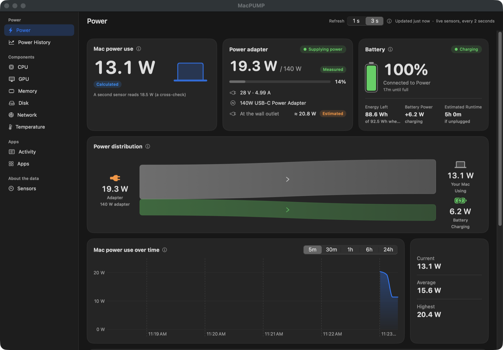
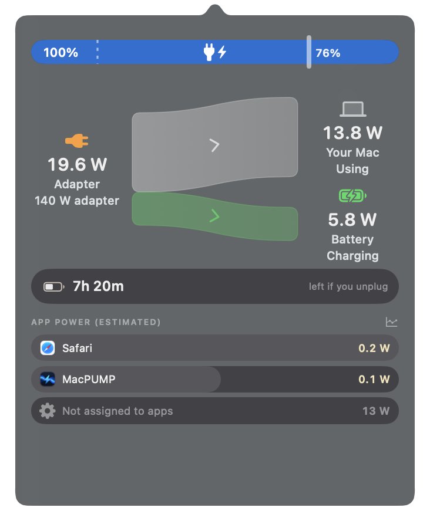
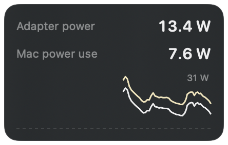
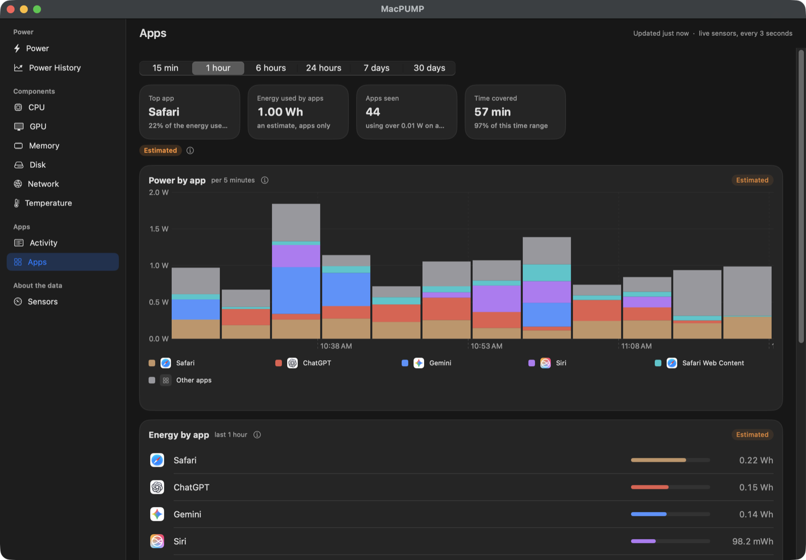
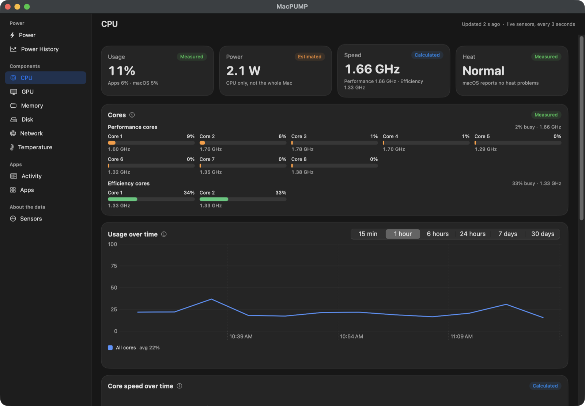
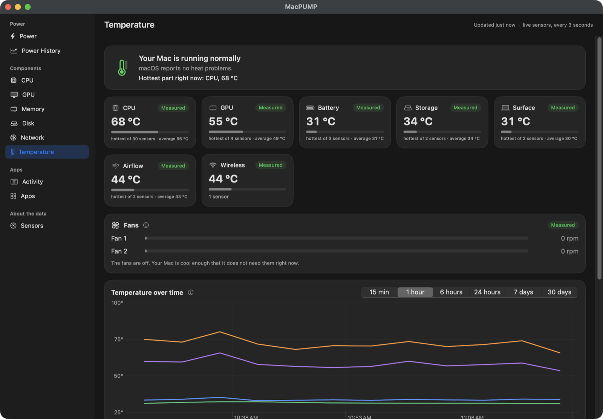
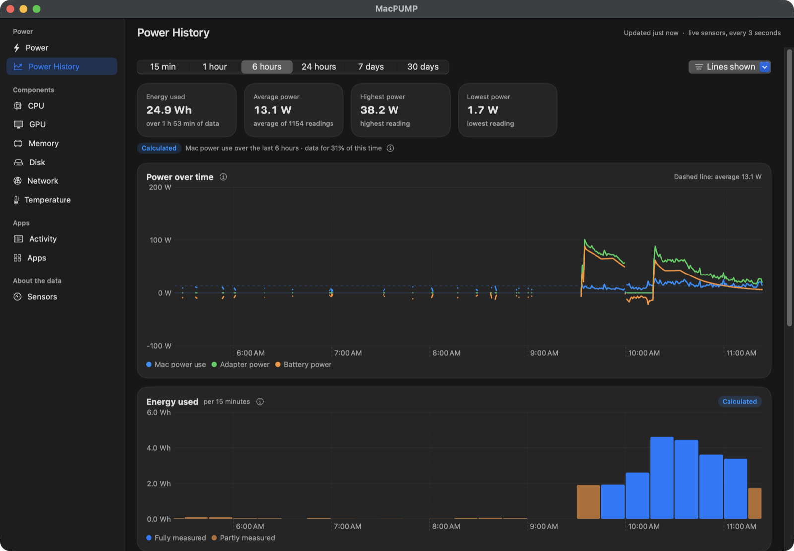
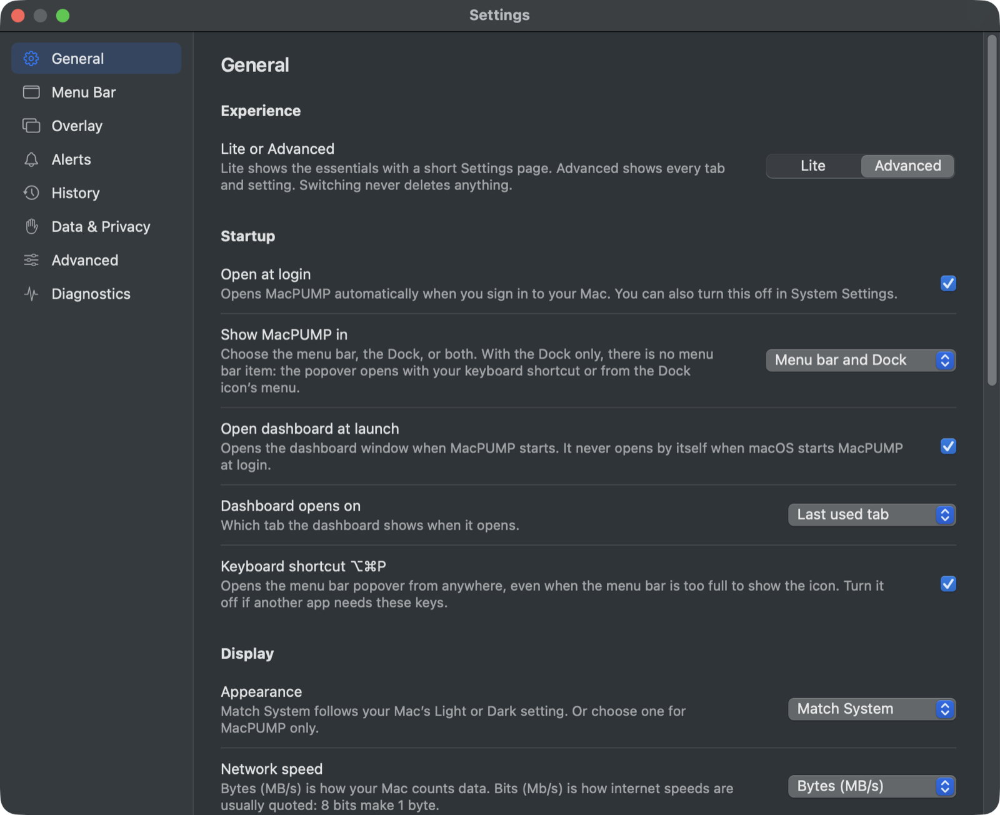

# MacPUMP

Are you:
- like me can't find a free solution online that caters to your OCD behaviour!
- Wanted to know how much your MAC is sucking the power out of adapter 24/7
- A lil bit too OBSESSIVE about battery life ( I know you are checking the battery life cycle everyday, don't lie to me )
- Want to check up to 30D of historical data?
- TRUE FREE to download + Resource Lite + fully private (no root access) app

What are you still waiting for? Download MacPUMP (Mac Power Usage Monitoring Program)—the all-in-one, ultimate monitor for your Mac for dummy and pro users alike. It shows where your Mac's power goes, which apps drain your precious battery, and how your Mac is really doing ALL THE DAMN TIME with ease of use in mind!

Check out the app, & drop a star on GitHub so other people can share the enjoyment of being a OCD freaks like you!

Let me know what you think, what features you want to see next, or if you run into any bugs. Feedback is super welcome! 

**[⬇︎ Download the latest version](https://github.com/PlayStationDONE/MacPUMP/releases/latest)**. It's free.

  

  
  &nbsp;&nbsp;
  

One click from your menu bar, or float it on top of everything. Your call.

## What it does

**See your power, live**
- A power distribution diagram showing how power flows between the charger, the battery and your Mac.
- Mac power use in watts, battery percentage, battery health, charge cycles, and how long the battery would last if
  you unplugged now.
- A breakdown by processor, graphics, display and everything else. Every number is labelled **Measured**,
  **Calculated** or **Estimated**, so you know how far to trust it.

**Find what drains your battery**
- Apps ranked by estimated power use, with history.
- What is keeping your Mac awake.

Apps: name and shame the battery hogs (politely, with estimates).

**Look inside your Mac** (Advanced mode)
- CPU usage, core speeds and power; GPU, memory, disk and network; temperatures and fans; the sensors your Mac
  provides.

CPU: every core, how busy it is and how fast it's going.

Temperature: is your Mac chill or spicy? Now you know.

**Look back in time**
- Charts from the last 15 minutes up to 30 days, energy used, battery health trend, a weekly report, and CSV export.

Power History: scroll back in time and see exactly when your Mac went on a snack run.

**Stay informed**
- A customisable menu bar popover, an optional floating power meter, alerts on the readings you care about, and
  reminders to unplug or plug in.

**Make it yours**
- **Lite** mode for the essentials, **Advanced** mode for everything. Switch any time in Settings.
- Show it in the menu bar, the Dock, or both. Light and Dark mode.

Settings: tweak to your heart's content. Or don't. Lite mode won't judge.

## Privacy

- No account, no tracking, no network connections. Nothing is sent anywhere.
- History is saved only on your Mac, in a folder only you can read. Export or delete it any time in
  Settings > Data & Privacy.
- MacPUMP never asks for your administrator password and does not change how your Mac charges.

## Requirements

- A Mac with **Apple silicon** (M1 or newer).
- **macOS 14** or later.

## Install

1. Download `MacPUMP-<version>.dmg` from [Releases](https://github.com/PlayStationDONE/MacPUMP/releases/latest).
2. Open it and drag **MacPUMP** into **Applications**.
3. Open MacPUMP. macOS will say it cannot verify the developer, because MacPUMP is not yet notarized by Apple.
   Open **System Settings > Privacy & Security**, scroll down and click **Open Anyway** next to MacPUMP, then
   confirm. You only need to do this once.

## Good to know

- MacPUMP has been properly tested on one Mac, a MacBook Pro with an M1 Pro. On other Apple silicon Macs some numbers
  may differ a little.
- Processor, display and per-app power are estimates, not exact measurements, because more detailed readings would
  need administrator access, which MacPUMP deliberately never asks for. Estimates are always labelled.
- MacPUMP only reads your Mac. Charge reminders send a notification; they do not limit charging.

## Licence

MacPUMP is **free to download and use**, at home or at work. It is **not open source**: you may not sell it, profit
from it, redistribute it, or modify it. See [LICENSE.md](LICENSE.md). It includes code from PowerFlow by Dylan under
the MIT License; see [THIRD_PARTY_NOTICES.md](THIRD_PARTY_NOTICES.md).

## Feedback and bugs

Open an [issue](https://github.com/PlayStationDONE/MacPUMP/issues). Please include your Mac model, macOS version and
the MacPUMP version (MacPUMP > About MacPUMP). For security problems, open an issue asking for a private contact
rather than posting details.
