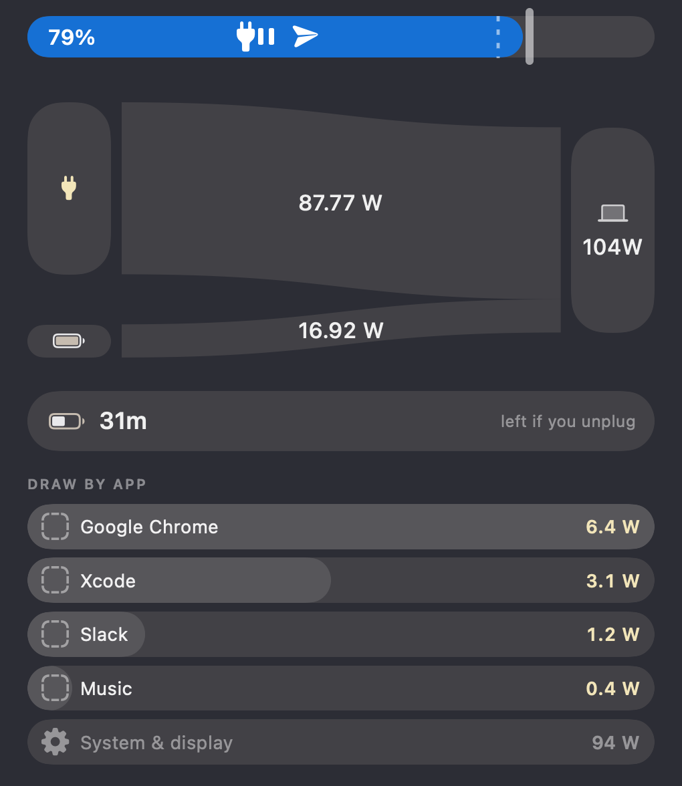
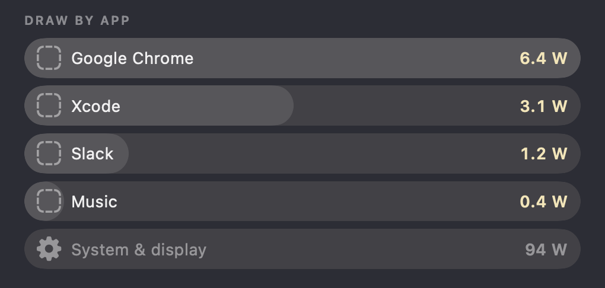

<p align="center">
  
</p>

<h1 align="center">MacPUMP</h1>

<p align="center">
  <strong>Mac Power Usage Monitoring Program</strong><br>
  See where your Mac's power goes. In plain English. Without handing over your root password.
</p>

<p align="center">
  <a href="https://github.com/PlayStationDONE/MacPUMP/releases/latest"><strong>⬇︎ Download the latest version</strong></a> · free · macOS 14+ · Apple silicon
</p>

<p align="center">
  
</p>

<p align="center"><sub>The menu bar popover, drawn by MacPUMP itself with sample readings.</sub></p>

---

## Why this exists

I was tired of it. Tired of opening the App Store, scrolling through a hundred "Mac monitor" apps, installing a few, and
coming away frustrated: too basic, too cryptic, too pushy, or asking for my administrator password to show me a number.

So I made the one I actually wanted: **an app that tells you where your Mac's power is going, which apps are draining
the battery, and how your Mac is really doing, without making you read a manual or trust a stranger with root access.**

It started life as a fork of [PowerFlow](https://github.com/dylansantwani/powerflow) by Dylan (thank you, Dylan!) and
grew up into something much bigger. Here it is. Say hi. 👋

## Meet the popover

Click the icon in your menu bar (or hit **⌥⌘P** from anywhere) and your Mac tells you, live:

- 🔌 **Where the power flows:** charger → battery → Mac, as one diagram. The three always add up.
- ⏳ **How long you'd last** if you yanked the cable right now.
- 🕵️ **Which apps are the culprits**, ranked by estimated power use.

No spreadsheets. No decoder ring.

### Your Mac has moods

The diagram redraws itself depending on what the battery is up to. Here are the four situations, rendered by the app
with its built-in sample readings:

<p align="center">
  
</p>

| Left to right | What's going on |
| --- | --- |
| **Plugged in, working hard** | Your Mac wants more than the charger can give, so the battery chips in |
| **Charging** | The charger feeds your Mac *and* tops up the battery |
| **On battery** | Everything your Mac uses comes out of the battery |
| **Fully charged** | The battery takes a nap while the charger does all the work |

### Find the battery hogs

<p align="center">
  
</p>

Apps are ranked by estimated watts. A browser's twenty helper processes get folded into the browser, so you see one row
per app, not a wall of noise. Power that can't be blamed on a single app (the display, macOS itself) gets its own
honest row instead of being sprinkled around to make the maths look prettier.

## Built for everyone, from "what's a watt?" to "give me the raw data"

MacPUMP has two modes, and you can flip between them any time in Settings. Nothing is deleted when you switch.

### 🌱 Lite: "I just want to know why my battery keeps dying"

The essentials, and nothing scary:

- Live **Power** and a **Power History** to look back through
- **Apps** ranked by power use
- **Temperature**
- Two simple switches for alerts: *battery's low* and *my Mac is hot*

### 🚀 Advanced: "I want every dial"

Everything in Lite, plus:

- **CPU** (per-core activity and core speeds), **GPU**, **Memory**, **Disk** and **Network** tabs, each with history
- **Activity**: what's keeping your Mac awake, and **Sensors**: what your Mac actually exposes and where each number comes from
- **Alerts on almost anything** (CPU, memory, disk space, battery, temperature, network) with quiet hours, an alert log and an optional Shortcut to run
- **Profiles** that swap your settings automatically on battery, on AC or with an external display, with import and export
- **Your own menu bar text**, like `CPU {cpu} · {temp}`, plus custom keyboard shortcuts
- An optional **floating overlay**: a small always-on-top power meter you can place in any corner
- **`macpump://` links** and a **`--status` command** for Shortcuts, scripts and other tools

```bash
# Current readings as JSON: battery, CPU, GPU, memory, disk and network
/Applications/MacPUMP.app/Contents/MacOS/MacPUMP --status
```

```text
macpump://dashboard/open?tab=CPU        open the dashboard on a tab
macpump://overlay/toggle                show or hide the floating overlay
macpump://profile/apply?name=Battery%20saver
```

Links only drive the interface. They can't read, export or delete anything.

### The menu bar, your way

<p align="center">
  
</p>

Icon only, with the percentage, or with live watts. Menu bar looking crowded? Press **⌥⌘P** and the popover opens
anyway.

## Look back in time

Your Mac's power story, kept on your Mac:

- Charts from the **last 15 minutes up to 30 days**
- Energy used, average, peak and minimum, with gaps left blank (a sleeping Mac is never counted as 0 W)
- A **battery health trend** and a **weekly report**
- **CSV export** for Numbers, Excel or Power BI

## Honest numbers (this is the nerdy bit we're proud of)

Some readings come straight from sensors. Some are worked out from those. And some are, frankly, educated guesses,
because the detailed figures need administrator access and **MacPUMP deliberately never asks for it.** So every number
wears a name tag:

| Label | Means |
| --- | --- |
| **Measured** | Read directly from a sensor in your Mac |
| **Calculated** | Worked out exactly from measured readings |
| **Estimated** | A model's best figure, with its limits explained |
| **Unavailable** | Your Mac doesn't provide it, so MacPUMP shows nothing instead of making something up |

## Privacy: the boring, good kind

- No account. No tracking. No network connections. Nothing is sent anywhere, ever.
- Your history lives in a folder only you can read. Export or delete it any time in **Settings > Data & Privacy**.
- No administrator password, and MacPUMP only *reads* your Mac. Charge reminders send a notification; they never limit
  or change charging.

## Requirements

- A Mac with **Apple silicon** (M1 or newer)
- **macOS 14** or later

## Install

1. Download `MacPUMP-<version>.dmg` from [Releases](https://github.com/PlayStationDONE/MacPUMP/releases/latest).
2. Open it and drag **MacPUMP** into **Applications**.
3. Open MacPUMP. macOS will say it cannot verify the developer, because MacPUMP is not yet notarized by Apple.
   Open **System Settings > Privacy & Security**, scroll down and click **Open Anyway** next to MacPUMP, then
   confirm. You only need to do this once.

## Good to know

- MacPUMP has been properly tested on one Mac, a MacBook Pro with an M1 Pro. On other Apple silicon Macs some numbers
  may differ a little.
- Processor, display and per-app power are estimates, not exact measurements, because more detailed readings would
  need administrator access, which MacPUMP deliberately never asks for. Estimates are always labelled.
- MacPUMP only reads your Mac. Charge reminders send a notification; they do not limit charging.

## Licence

MacPUMP is **free to download and use**, at home or at work. It is **not open source**: you may not sell it, profit
from it, redistribute it, or modify it. See [LICENSE.md](LICENSE.md). It includes code from PowerFlow by Dylan under
the MIT License; see [THIRD_PARTY_NOTICES.md](THIRD_PARTY_NOTICES.md).

## Feedback and bugs

Found a bug? Got an idea? Open an [issue](https://github.com/PlayStationDONE/MacPUMP/issues). Please include your Mac
model, macOS version and the MacPUMP version (MacPUMP > About MacPUMP). For security problems, open an issue asking for
a private contact rather than posting details.

<p align="center"><sub>Made because the App Store scroll of despair is real. 🔋</sub></p>
